# 第二十一届全国大学生智能汽车竞赛

## 雁过留痕组技术报告

### 基于 STC32G144K246 的视觉循迹与激光打靶智能车设计

**表 0.1 报告基本信息**

| 项目 | 内容 |
|---|---|
| 参赛学校 | 湖北文理学院 |
| 队伍名称 | 湖文孔明九队 |
| 竞赛组别 | 雁过留痕 |
| 参赛队员 | 李昊澎、杨周、黄昶锦 |
| 带队教师 | 安忙忙 |
| 报告日期 | 2026 年 8 月 |

---

## 技术报告及研究论文使用授权说明

本人/本队伍确认：本技术报告由参赛队员在带队教师指导下独立完成，所涉及的设计方案、硬件制作、软件开发、调试数据及实验结论均应真实反映参赛作品的实际情况。对于引用的外部资料、开源库和第三方工具，已在正文或参考文献中进行说明。


**图 0.1 技术报告及研究论文使用授权说明**

---

## 目录

1. [引言](#第一章-引言)
2. [系统总体方案](#第二章-系统总体方案)
3. [车模机械结构与传感器安装](#第三章-车模机械结构与传感器安装)
4. [电路系统设计](#第四章-电路系统设计)
5. [微处理器控制软件与算法](#第五章-微处理器控制软件与算法)
6. [开发、制作、安装与调试过程](#第六章-开发制作安装与调试过程)
7. [主要技术参数与测试结果](#第七章-主要技术参数与测试结果)
8. [结论与展望](#第八章-结论与展望)
9. [参考文献](#参考文献)
10. [附录](#附录)

---

## 主要符号与缩略词

**表 0.2 主要符号与缩略词**

| 符号/缩略词 | 含义 |
|---|---|
| MCU | 微控制器（Microcontroller Unit） |
| HAL | 硬件抽象层（Hardware Abstraction Layer） |
| PIT | 周期中断定时器 |
| PWM | 脉宽调制 |
| PID | 比例-积分-微分控制器 |
| UART | 通用异步收发器 |
| SPI | 串行外设接口 |
| IIC | 集成电路间总线 |
| ToF | 飞行时间测距 |
| `camera_value` | 视觉前瞻误差，代码中按 100 倍整数参与控制 |
| `Island_State` | 环岛状态机状态变量 |
| `Stop_flag` | 车辆运行/停止状态标志 |
| `mod_flag` | 自动、参数或手动激光控制模式变量，具体模式命名待结合队伍协议补充 |

---

# 第一章 引言

## 1.1 研究背景

根据竞赛通知，参赛队伍需提交能够反映车模设计、制作和调试过程的技术报告，并同步准备车模检查材料。<sup>[1]</sup>

全国大学生智能汽车竞赛要求参赛队伍在限定车模、器件及赛道规则下，完成机械结构、电路系统、嵌入式软件和控制算法的协同设计。雁过留痕组的核心任务是使车模在复杂赛道环境中完成稳定循迹，并对赛道中的目标进行可靠检测与激光打击。因此，系统不仅需要具备高速图像采集和边界识别能力，还需要将视觉误差、编码器反馈、惯性信息、距离信息和执行机构控制统一到确定性的实时闭环中。

本项目以 STC32G144K246 为核心控制器，构建了由摄像头视觉感知、赛道语义识别、双轮速度控制、舵机方向控制和多路激光执行组成的嵌入式智能车系统。系统采用裸机事件驱动架构：主循环处理摄像头帧事件，1 ms 周期中断负责控制与保护任务，UART2 中断负责在线调参与状态控制。

## 1.2 研究内容

本报告围绕以下内容展开：

- 车模机械结构、传感器和自制电路板的安装方案；
- STC32G144K246 控制系统及外设接口设计；
- 基于 MT9V03X 灰度图像的赛道边界提取和前瞻误差计算；
- 环岛、十字、直道、斑马线和坡道等赛道元素的识别方法；
- 基于编码器反馈的双轮速度闭环和基于视觉误差的舵机闭环；
- 目标检测、激光通道选择、延迟补偿及脉冲输出策略；
- 软硬件联调方法、测试指标及后续优化方向。

## 1.3 报告结构

第一章说明研究背景与报告范围；

第二至四章介绍总体方案、机械结构和电路系统；

第五章重点说明软件架构、视觉算法与控制算法；

第六章总结开发调试过程；第七章给出技术参数和测试结果；

第八章总结工作并提出改进方向。

---

# 第二章 系统总体方案

## 2.1 设计目标与约束

系统设计目标包括：

1. 在规定车模和器件约束下完成稳定、连续的赛道循迹；
2. 对环岛、十字、直道、斑马线和坡道等典型场景进行状态化处理；
3. 建立视觉前瞻误差到舵机角度的快速控制链路；
4. 建立编码器反馈到双电机 PWM 输出的速度闭环；
5. 在目标出现时完成激光通道选择和时序补偿；
6. 支持通过 UART2 对运行参数进行在线调整，缩短调试周期。

系统受到 MCU 计算能力、摄像头帧率、车模尺寸、供电能力、器件白名单及赛道规则等约束。

## 2.2 总体架构

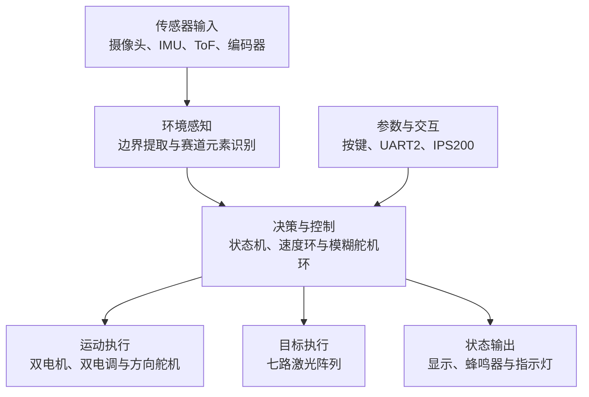

**图 2.1 系统总体架构图**

## 2.3 实时任务组织

系统采用三个相互协作的事件域：

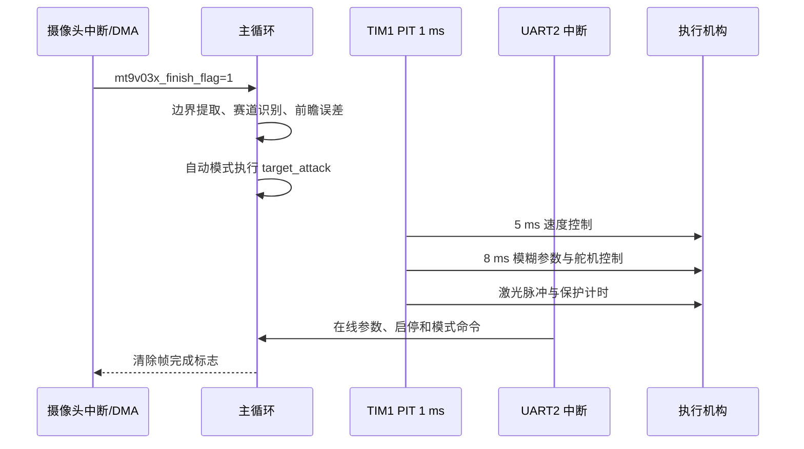

**图 2.2 实时事件协作时序图**

## 2.4 系统运行流程

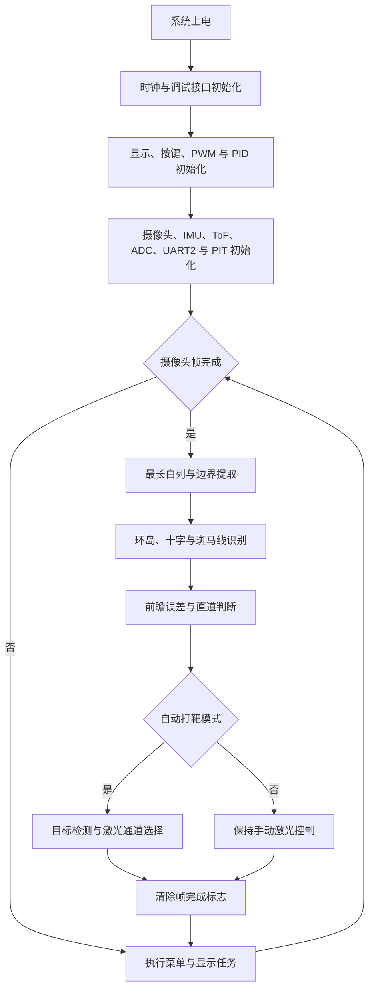

**图 2.3 主循环流程图**

---

# 第三章 车模机械结构与传感器安装

## 3.1 车模总体结构

当前工程软件面向四轮智能车平台，底盘执行机构包括左右驱动电机、方向舵机和双路电调。视觉传感器安装在车体前部，用于获取前方赛道灰度图像；显示屏和按键安装在便于调试的位置；激光阵列安装在车体前方目标投射区域。


**图 3.1 参赛车模总体结构**

## 3.2 传感器安装与坐标约定

视觉算法使用图像坐标系描述目标位置，图像横坐标从左向右增大，纵坐标从上向下增大。程序根据赛道状态选择不同的目标检测行：直道使用较高的固定行，环岛后段使用较低的检测行，弯道使用中间检测行。

编码器安装于左右驱动轮，用于获取速度反馈；IMU 用于辅助环岛航向变化判断；DL1B 用于坡道或前方距离状态判断。


**图 3.2 七路激光阵列安装位置**


**图 3.3 MT9V03X 摄像头安装结构**


**图 3.4 DL1B ToF 测距模块安装位置**


**图 3.5 IMU660RC 安装位置**

| 左侧编码器 | 右侧编码器 |
|:---:|:---:|
|  |  |

**图 3.6 左右轮编码器安装位置**

---

# 第四章 电路系统设计

## 4.1 主控与电源

系统以 STC32G144K246 为主控制器，工程启动时配置系统时钟为 99 MHz。主控通过 GPIO、UART、SPI、Soft-IIC、ADC、PWM、PIT、定时器和外部中断接口连接各类传感器和执行机构。

根据实际使用原理图，主板以 12 V 为主要输入电源，并设置浪涌抑制和输入滤波。电源部分划分为 5 V、3.3 V、摄像头独立 3.3 V 和 8.18 V 四条主要支路：

- U2 采用 MP2315SGJ-Z 同步降压芯片，将 12 V 转换为 5 V，功率电感 L2 为 4.7 μH；
- U1 采用 TLV62568DBVR，将 5 V 转换为系统 3.3 V，功率电感 L3 为 2.2 μH；
- U3 采用 RT9013-33GB 低压差稳压器，由 5 V 产生摄像头专用 3.3 V 电源，以减小数字负载和执行机构噪声对图像采集的干扰；
- U9 再次采用 MP2315SGJ-Z，将 12 V 转换为约 8.18 V，作为舵机等执行机构的独立电源，功率电感 L4 为 6.8 μH。

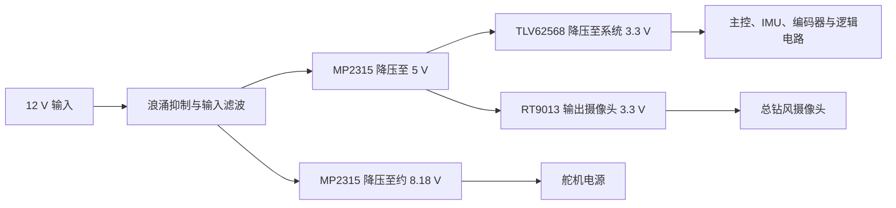

**图 4.1 主板电源域结构图**


**图 4.2 主板电源原理图**

## 4.2 直流电机驱动电路

直流电机驱动模块采用左右两路相互独立的全桥结构，每路均由 DRV8701E 栅极驱动器和四只功率 MOSFET 组成，用于驱动车模左右两侧的 RS380 电机。主控输出的 `PH1/PH2` 方向信号和 `EN1/EN2` PWM 使能信号经接口与缓冲电路送入驱动器，由驱动器控制 H 桥上下桥臂交替导通，实现电机正反转、制动和转速调节。电路同时设置输入滤波与去耦、独立电机及电源接口、使能开关和状态指示灯，便于减小开关噪声影响并开展单通道调试。直流电机驱动电路的整体组成如图 4.3 所示。


**图 4.3 直流电机驱动电路原理图**

## 4.3 无刷电机驱动电路

无刷电机驱动模块采用独立 STC 单片机完成电调控制，主要由信号输入、串口下载、电源输入与 5 V 稳压、母线电压检测、换相检测、三相栅极预驱以及六管功率级组成。控制器接收上位主控给出的运行信号，并利用三相反电动势检测结果判断转子位置和换相时刻，随后生成三路互补 PWM 信号，经预驱与自举电路控制三相桥臂 MOSFET。该结构实现了无位置传感器条件下的电子换相和功率输出，同时通过电压检测与 LED 指示为欠压判断、工作状态确认及现场调试提供依据。无刷电调各功能单元及其连接关系如图 4.4 所示。


**图 4.4 STC电调原理图**

## 4.4 外设接口分配

**表 4.1 主要外设接口分配**

| 功能 | 接口/资源 | 软件模块 |
|---|---|---|
| 总钻风摄像头 | 并行数据、PCLK、SCL、SDA、HREF；AL422B 帧缓存 | `zf_device_mt9v03x` |
| IMU660RC | SPI、INT2 | `zf_device_imu660rc` |
| ToF 测距 | 专用排针，Soft-IIC 与 GPIO 中断 | `zf_device_dl1b` |
| IPS200 显示 | SPI、复位、数据/命令、背光控制 | `zf_device_ips200` |
| 在线调参 | UART2，115200 bit/s | `camera_rx_interrupt_handler()` |
| 电机信号 | PH1/PH2 与 EN1/EN2 输入接口 | `moter.c` |
| 舵机 | 独立 8.18 V 供电及 PWM 接口 | `Steering_Servo_Control()` |
| 速度反馈 | 两组正交编码器接口 | `get_encoder()` |
| 电池监测 | ADC2_CH0_P00 | `adc_mean_filter_convert()` |
| 激光阵列 | 七路 AO3400 MOSFET 低端开关 | `LED_open()` |
| 人机交互 | 四个独立按键、蜂鸣器和电源开关 | `key.c`、`menu.c` |
| 扩展通信 | 无线调试器与多组串口排针 | UART 驱动 |

主控与接口原理图显示，STC32G144K246 核心板通过板间连接器与主板连接。摄像头数据经 AL422B 帧缓存接入主控；七路激光分别采用 AO3400 MOSFET 驱动；蜂鸣器由 S8050 三极管驱动；编码器、IMU、ToF、IPS200、舵机和串口均设置独立接口，便于装配、维护与赛前检查。


**图 4.5 主板控制与接口原理图**

## 4.5 PCB 布局与布线

主板采用圆角矩形外形并设置四个机械固定孔。核心板位于 PCB 中部，摄像头及显示相关接口位于上部和右侧，按键沿左侧排列，电机、编码器、舵机和电源连接器布置在板边，便于车模线束从不同方向接入。多路开关电源集中布置在板底部区域，七路激光驱动集中布置，既减少了高电流回路长度，也便于按功能检查输出通道。

PCB 正反面均采用大面积覆铜，并通过过孔实现地参考连接。敏感信号与功率区域在空间上进行分区，但最终报告仍应补充实测纹波、电磁干扰和热稳定性数据，以验证布局设计效果。


**图 4.6 主板 PCB 正面布局**


**图 4.7 主板 PCB 背面布局**


**图 4.8 电调 PCB 正面布局**


**图 4.9 电调 PCB 背面布局**


**图 4.10 直流电机驱动 PCB 正面布局**


**图 4.11 直流电机驱动 PCB 背面布局**

---

# 第五章 微处理器控制软件与算法

## 5.1 软件分层结构

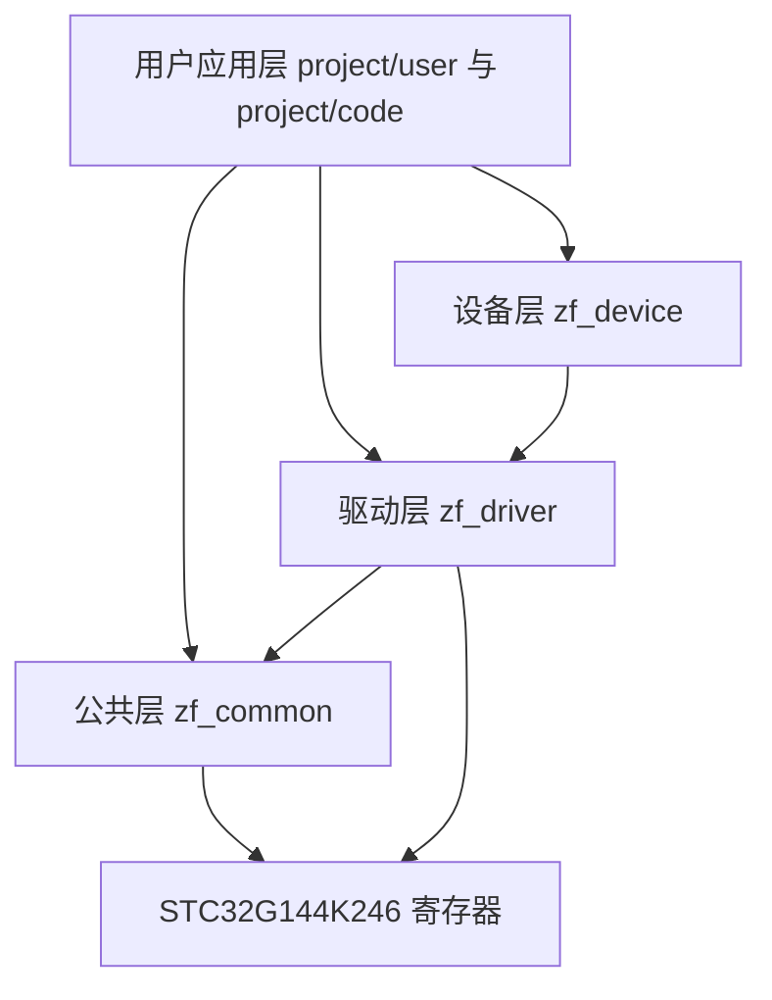

**图 5.1 软件分层结构图**

公共层提供时钟、调试、FIFO、中断注册和通用函数；驱动层提供 MCU 外设访问接口；设备层对摄像头、IMU、显示屏和 ToF 等设备进行协议封装；用户层完成赛道理解、控制算法、显示和在线调参。

## 5.2 视觉边界提取

视觉主链路以 MT9V03X 图像为输入，首先通过动态阈值和最长白列方法搜索左右赛道边界，再根据边界有效性执行丢线补偿、中心线计算和前瞻误差计算。

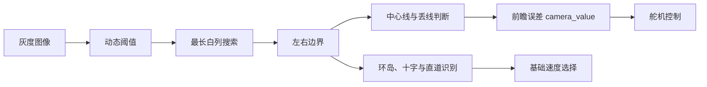

**图 5.2 视觉信息处理流程图**

当前源码中的主要视觉函数包括 `Longest_White_Column()`、`Prospective_error()`、`Cross_Detect()`、`Straight_Detect()`、`Zebra_Found_stop()` 和 `target_attack()`。

## 5.3 环岛状态机

左右环岛共享 `Island_State`，并以 `Left_Island_Flag` 与 `Right_Island_Flag` 区分左右方向。状态 0 表示正常巡线，状态 1～6 依次覆盖入口候选、入口过渡、环岛内循迹、出口识别、出环补线和恢复确认。

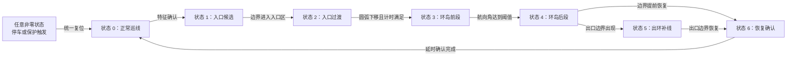

**图 5.3 环岛状态机图**

## 5.4 速度与舵机控制

车辆控制采用左右轮增量式速度环与模糊自整定舵机方向环相互配合的结构。编码器采样周期为 5 ms，方向控制周期为 8 ms。模糊推理并非独立的预留模块：系统初始化时调用 `InitMH()`，将标定结构 `MHstructFastCar` 复制到运行结构 `MHstruct`，从而装载模糊规则和比例系数表；运行过程中每个舵机控制周期均调用 `DuoJi_GetP()`，实时更新 `pid_camera.Kp1`，随后再执行 `camera_pid_realize()` 计算舵机控制量。

### 5.4.1 左右轮增量式速度控制

速度环根据环岛、直道、坡道和普通弯道状态选择基础速度，再通过 `Ackerman_diff()` 生成左右轮目标值。左右编码器控制器采用增量式 PID 形式：

$$
\Delta u(k)=K_p[e(k)-e(k-1)]+K_i e(k)+K_d[e(k)-2e(k-1)+e(k-2)]
$$

当前参数中左右轮均取 $K_p=20$、$K_i=20$、$K_d=0$，因此实际为增量式 PI 控制，输出限幅为 $[-7000,7000]$。该结构利用编码器反馈抑制左右电机差异，并与阿克曼差速目标共同改善转弯时的轮速匹配。

### 5.4.2 模糊比例系数在线整定

模糊控制器使用两个输入变量：

- $H$：`ImageStatus_OFFLine`，由图像高度减去有效搜索终止行得到，用于表征当前图像有效边界长度和视觉质量；
- $E$：`-camera_value / 100`，表示归一化后的横向方向误差，并在进入模糊推理前限制在 $[-30,30]$。

程序采用 `FUZZY_SCALE=100` 的定点数表示。两个输入分别映射至 $[0,3]$ 的模糊论域：

$$
h_f=\operatorname{sat}_{[0,3]}\left(\frac{3(H-2)}{90}\right),\qquad
e_f=\operatorname{sat}_{[0,3]}\left(\frac{3|E|}{30}\right)
$$

**表 5.1 舵机比例系数模糊规则表**

| $H\backslash \lvert E\rvert$ | 0 | 1 | 2 | 3 |
|---:|---:|---:|---:|---:|
| 0 | 0 | 1 | 2 | 3 |
| 1 | 1 | 2 | 3 | 4 |
| 2 | 3 | 4 | 5 | 6 |
| 3 | 5 | 6 | 6 | 6 |

`DuoJi_GetP()` 对相邻四个规则节点进行线性插值并取组合结果，得到 0～6 之间的连续输出等级。随后在比例系数表

$$
[2.00,\ 2.25,\ 2.92,\ 3.25,\ 3.55,\ 3.69,\ 3.92]
$$

之间再次插值，生成实时比例系数 $K_p$。代码为左右方向分别预留了参数表，当前两侧数值相同；若实车存在左右舵机机构或轮胎特性差异，可分别标定两组参数，从而实现非对称补偿。

从规则表可见，当图像有效边界缩短或方向误差增大时，模糊输出等级整体提高，使舵机比例作用增强；在误差较小且边界较完整时采用较低增益，以减少直线行驶时的高频摆动。因此，该方法本质上是一种依据视觉质量与横向误差进行在线增益调度的模糊自整定控制。

### 5.4.3 舵机 PD 输出

模糊推理得到 $K_p$ 后，方向环根据视觉误差计算动态微分系数：

$$
K_D=\max\left(K_{D\min},\ K_{D2}+\frac{e^2}{10K_{D1}}\right)
$$

舵机控制量为：

$$
u(k)=K_p e(k)+K_D[e(k)-e(k-1)]
$$

其中各系数在程序中采用 100 倍定点表示，并在输出前执行限幅。最终 PWM 由舵机中值减去比例缩放后的控制量得到。尽管 `PID_CONTROL` 当前选择了 `IMU660_CONTROL` 分支，模糊比例系数更新位于该分支之外并在主循环调度中显式执行，因此实际方向控制链可概括为“模糊在线整定 $K_p$ + 非线性动态 $K_D$ 的视觉 PD 控制”。

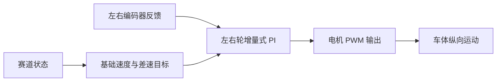

**图 5.4(a) 左右轮速度闭环结构图**

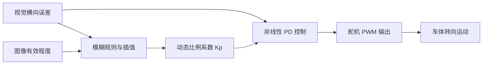

**图 5.4(b) 模糊自整定舵机方向环结构图**

车辆停止时舵机回到中值；车辆启动过程采用电调渐增策略，以降低静止起步时的瞬时冲击。

## 5.5 激光目标检测与通道选择

当前自动打靶算法在选定图像行内扫描灰度跳变，得到目标左右边缘并计算目标中心 `huan_X`。随后根据环岛方向、弯道方向和目标宽度进行横向补偿及图像延迟补偿，再将横坐标映射为七路激光位码 `64、32、16、8、4、2、1`。

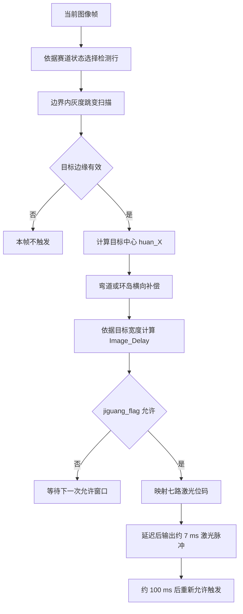

**图 5.5 自动激光打靶流程图**

## 5.6 UART2 在线调参与协议

UART2 使用 115200 bit/s，协议状态机以 `A` 为起始标志、以命令字节区分操作、以 `M` 作为数据结束标志。命令可用于启动、停车、设置速度、调节 PID、修改前瞻参数、切换模式和直接设置激光位码。

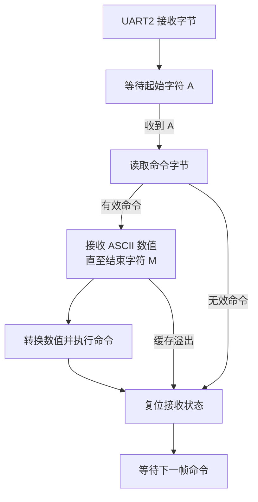

**图 5.6 UART2 协议状态机图**

## 5.7 周期任务

**表 5.2 周期任务分配**

| 周期 | 主要任务 |
|---|---|
| 1 ms | 激光时序、启动/停车/蜂鸣器/斑马线/保护计时 |
| 5 ms | 编码器采样、基础速度选择、速度 PID 和电机输出 |
| 8 ms | 模糊比例系数推理、动态微分系数计算与舵机输出 |
| 20 ms | 按键扫描 |
| 40 ms | IMU 相关周期状态处理 |
| 100 ms | UART2 遥测和激光触发窗口管理 |
| 3000 ms | 电池电压 ADC 采样 |

---

# 第六章 开发、制作、安装与调试过程

## 6.1 开发环境

工程采用 Keil MDK for C251，推荐版本为 V5.60。主工程位于 `project/mdk/seekfree.uvproj`，用户代码位于 `project/code` 与 `project/user`，库代码位于 `libraries`。报告正文、章节和附录的组织依据竞赛技术报告细则执行。<sup>[2]</sup>

## 6.2 软件开发流程

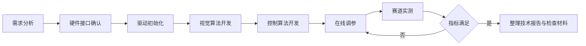

**图 6.1 软件与调试流程图**

## 6.3 参数调试方法

调试按照“先硬件、后驱动、再视觉、最后控制”的顺序进行。首先验证电源、传感器通信和 PWM 输出；随后检查图像边界、环岛状态和前瞻误差；最后逐步调整舵机 PID、速度 PID、基础速度、动态阈值和激光延迟参数。

**1.串口调试**

串口调试主要用于验证 UART2 通信协议并进行运行参数的在线调整。调试时将串口配置为 115200 bit/s、无校验、1 位停止位，采用文本模式观察车辆周期上传的状态数据，同时发送以 `A` 为帧头、`M` 为帧尾的控制指令。通过检查数据接收是否连续、指令应答是否正确以及参数修改后车辆状态是否同步变化，可以快速定位通信异常，并验证启停、模式切换和参数设置等功能。


**图 6.2 UART2 串口在线调试界面**

**2.图传调试**

图传调试用于直观检查视觉算法对赛道图像的处理效果。通过逐飞助手接收或回放摄像头图像，并在画面上叠加左右赛道边界和计算得到的中心线，可以逐帧观察弯道区域的边界连续性、中心线位置及丢线情况。调试人员根据显示结果调整动态阈值、扫线范围、补线规则和前瞻参数，使视觉输出能够稳定反映实际赛道走向，并为后续舵机控制提供可靠误差输入。


**图 6.3 视觉图传调试界面**

# 第七章 主要技术参数与测试结果

## 7.1 技术参数

**表 7.1 技术参数**

| 参数 | 当前工程值/状态 | 依据 |
|---|---:|---|
| 主控 | STC32G144K246 | 工程目标与启动代码 |
| 系统时钟 | 99 MHz | `clock_init(SYSTEM_CLOCK_99M)` |
| 摄像头 | MT9V03X | `mt9v03x_init()` |
| IMU | IMU660RC（配置开关启用） | `imu660rc_init()` |
| ToF | DL1B | `dl1b_init()` |
| 显示 | IPS200 | `ips200_init()` |
| 在线调参串口 | UART2，115200 bit/s | `main.c` |
| 速度环周期 | 5 ms | `pit1_handler()` |
| 舵机环周期 | 8 ms | `pit1_handler()` |
| 自动激光触发窗口 | 约 100 ms | `Tick.jiguang_time` |
| 激光通道 | 七路位码 | `target_control()` |

## 7.2 技术指标

**表 7.2 技术指标**

| 指标 | 测试结果 |
|---|---|
| 整车质量（kg） | **1.494kg** |
| 长、宽、高（mm） | **292 x 323 x 343** |
| 车模类型 | **C车模** |
| 传感器种类（种） | **4种** |
| 传感器个数（个） | **5个** |
| 电机型号         | **RS380** |
| 舵机型号 | **BDS300** |

# 第八章 结论与展望

## 8.1 工作总结

本项目完成了基于 STC32G144K246 的智能车软硬件系统设计，形成了从摄像头图像采集、赛道边界提取、赛道状态识别、双闭环控制到激光执行的完整技术链路。通过将主循环帧处理、PIT 周期控制和 UART2 在线调参进行分工，系统具备较清晰的实时任务边界和参数迭代能力。

## 8.2 现阶段不足

1. 机械结构尺寸、整车质量和功耗等项目书必需数据尚未在仓库资料中形成统一实测表；
2. 视觉算法中的动态阈值、边界补线和目标检测参数仍需要在不同光照条件下进行鲁棒性验证；
3. 环岛状态机依赖图像边界质量和 IMU 航向变化，极端丢线场景下仍需增加故障回退策略；
4. 自动打靶算法当前主要使用几何和灰度跳变规则，目标预测算法的系统性标定和对比实验尚待完成；
5. 目前参数仍存在不稳定性，部分传感器数据仅经简单处理后使用；
6. 硬件部分尚未完善，导致整车上限不高，提升空间不大；

## 8.3 后续改进方向

- 建立统一的标定数据文件，减少不同场地调参时的人工重复工作；
- 将视觉误差、编码器速度和 IMU 航向数据纳入统一日志，开展离线误差分析；
- 对环岛状态转换和激光目标检测进行统计学测试，报告成功率、误报率和平均处理时间；
- 对激光延迟补偿建立距离、速度、目标位置的标定模型；
- 在不改变竞赛合规边界的前提下优化布线、减振、散热和电源完整性；
- 将传感器数据整体融入控制算法中，加强整体控制精确度；
- 加强对硬件部分关键组件的研究，以期达到更好的系统性能；

---

# 参考文献

[1] 卓晴. 第二十一届全国大学生智能汽车竞赛提交技术报告和车模检查视频通知[EB/OL]. 2026-08-08. https://zhuoqing.blog.csdn.net/article/details/163552826.

[2] 卓晴. 第二十一届全国大学生智能汽车竞赛技术报告要求细则[EB/OL]. 2026-08-08. https://zhuoqing.blog.csdn.net/article/details/163553155.

[3] 逐飞科技. 逐飞科技 STC32G144K 100Pin 开源库[EB/OL]. 项目仓库 README 及源代码.

[4] Seekfree STC32G144K 工程架构说明. `docs/architecture/ARCHITECTURE_ANALYSIS.md`.

---

# 附录

## 附录 A 核心源代码目录

**1.主循环部分**

主循环负责完成系统初始化以及各功能模块的事件调度。程序上电后首先配置 99 MHz 系统时钟、调试串口和车载外设，随后进入无限循环。检测到摄像头帧完成标志后，程序依次执行最长白列搜索、动态阈值修正、斑马线停车判断、环岛与十字识别、前瞻误差计算、直道判断及目标攻击，并在本帧处理结束后清除完成标志。无新图像帧时，主循环继续处理菜单和显示任务，从而将视觉处理与人机交互组织在同一事件驱动框架内。

```c
void main(void)
{
    clock_init(SYSTEM_CLOCK_99M); 				// 时钟配置及系统初始化<务必保留>
    debug_init();                       		// 调试串口信息初始化

    // 此处编写用户代码 例如外设初始化代码等
		system_init();
		
    // 此处编写用户代码 例如外设初始化代码等

    while(1)
    {
        // 此处编写需要循环执行的代码

			 if(mt9v03x_finish_flag)
        {
						count = 0;
						count_flag = 1;
						if(ips_flag == 0)
						{
							 if(camera_display==1)ips200_displayimage03x(mt9v03x_image[0], 188, 120);
						}
						Longest_White_Column();
						daba_dynamic_threshold = dynamic_threshold -40;
						if(Zebra_time_flag==0 && Stop_flag==0 && Zebra_start_flag == 2)Zebra_Found_stop();
						huandao_mode();
						Cross_Detect();
						camera_value=(int32)(Prospective_error() * 100.0f);
						Straight_Detect();
						if(mod_flag != 2)target_attack();
						if(ips_flag == 0){if(camera_display==1)show_line();}
            			mt9v03x_finish_flag = 0;
						count_flag = 0;
        }
				menu_set();
				if(ips_flag == 0)
				{
						ips200_show();
				}
				else
				{
						if(clear_flag == 1){ips200_clear(RGB565_WHITE);clear_flag = 0;}
				}
						if(clear_flag == 1){ips200_clear(RGB565_WHITE);clear_flag = 0;}
    }
}
```

**2.差比和视觉扫线**

该函数用于在指定图像行内由右向左搜索左侧赛道边界。程序优先利用前两行已检测到的左边界缩小本行搜索范围，再以固定步长比较两个采样点的灰度值。采样点经动态阈值二值化后，通过“差值与和值之比”计算归一化边缘强度；当边缘强度超过阈值 `sar_thre` 时，将当前位置记录为左边界并返回有效标志。若整行未发现满足条件的跳变，则返回丢线状态，供后续中心线估计和补线逻辑使用。

```c
uint8 difsum_left(uint8 y, uint8 x) {
    int16 sum, dif, sar;
    int col;
    int mov = 3; 
    Left_Line[y] = 0; // 默认值设为图像左边缘

    if (y <= MT9V03X_H - 3 && mt9v03x_image[y][Left_Line[y+2]+8] >= (dynamic_threshold-30)
			&& mt9v03x_image[y][Left_Line[y+2]+7] >= (dynamic_threshold-30)&& mt9v03x_image[y][Left_Line[y+2]+9] >= (dynamic_threshold-30))
    {
        x=Left_Line[y+2]+9;
    }
    if (x <= mov + 1) return 0; 
    for (col = x; col >= mov + 1; col -= mov) {
        // 差比和逻辑
				if(mt9v03x_image[y][col] < dynamic_threshold - 50)mt9v03x_image[y][col]=0;
				else mt9v03x_image[y][col]=255;
				if(mt9v03x_image[y][col - mov - 1] < dynamic_threshold - 50)mt9v03x_image[y][col - mov - 1]=0;
				else mt9v03x_image[y][col - mov - 1]=255;
			
        dif = (mt9v03x_image[y][col] - mt9v03x_image[y][col - mov - 1]);
        sum = (mt9v03x_image[y][col] + mt9v03x_image[y][col - mov - 1]);
        // 分母保护：防止 sum 为 0 导致溢出
        if (sum < 1) sum = 1; 
        sar = ((int32)dif * 255) / sum;
				if(sar < 0){sar=-sar;}
        if (sar > sar_thre) {
            Left_Line[y] = (int16)(col - mov);
            return 1; // 成功找到线
        }                
    }
    return 0; // 整个循环结束没找到，判定为丢线
}
```

**3.PID控制算法**

左右轮速度控制采用相同结构的增量式 PID 算法。函数以目标编码器值与实际反馈值之差作为当前误差，根据当前误差、上一次误差和上上次误差计算输出增量，并累加到电机 PWM 控制量。累加结果经过上下限约束后输出，同时更新历史误差。当前工程中微分系数为零，因此实际运行表现为增量式 PI 控制；左右轮分别保存控制状态，以避免两路误差相互影响。

```c
int16 PID_realize_encoder_L(int16 Kp, int16 Ki, int16 Kd, int16 set_pwm, int16 pwm ,int16 out_max ,int16 out_min)
{
  
    err_l = set_pwm - pwm;
    
    out_pwm_l += Kp * (err_l - err_last_l) + Ki * err_l
                            + Kd * (err_l - 2 * err_last_l + err_last2_l);

    if (out_pwm_l > out_max)out_pwm_l = out_max;
    if (out_pwm_l < out_min)out_pwm_l = out_min;
    err_last2_l = err_last_l;
    err_last_l = err_l;
    
    return out_pwm_l;
}

int16 PID_realize_encoder_R(int16 Kp, int16 Ki, int16 Kd, int16 set_pwm, int16 pwm ,int16 out_max ,int16 out_min)
{
  
    err_r = set_pwm - pwm;
    
    out_pwm_r += Kp * (err_r - err_last_r) + Ki * err_r
                            + Kd * (err_r - 2 * err_last_r + err_last2_r);

    if (out_pwm_r > out_max)out_pwm_r = out_max;
    if (out_pwm_r < out_min)out_pwm_r = out_min;
    err_last2_r = err_last_r;
    err_last_r = err_r;
    
    return out_pwm_r;
}

```

舵机方向环以期望方向值和视觉输入值之差作为横向误差，并依据误差平方在线调整微分系数。误差在计算前进行限幅，以防止平方运算溢出；动态微分系数不得低于 `KD_limit`，比例项和微分项则按定点比例共同生成舵机控制量。函数最后更新历史误差并对输出限幅，使舵机 PWM 始终处于机构允许范围内。

```c
int32 camera_pid_realize(int32 adpid, int32 input)
{
    int32 KD = 0;
    int32 tiaoshi = 0;
    int32 duty_tmp = 0;

    pid_camera.SetAngle_v = adpid;
    pid_camera.ActualAngle_v = input;
    pid_camera.err = pid_camera.SetAngle_v - pid_camera.ActualAngle_v;

    /* Overflow guard for err*err. Normal camera error is far below this range. */
    if(pid_camera.err > 30000) pid_camera.err = 30000;
    else if(pid_camera.err < -30000) pid_camera.err = -30000;

    if(pid_camera.Kd1 != 0)
    {
        tiaoshi = (pid_camera.err * pid_camera.err) / (10 * pid_camera.Kd1);
    }
    else
    {
        tiaoshi = 0;
    }

    KD = pid_camera.Kd2 + tiaoshi;
    if(KD < KD_limit) KD = KD_limit;
    KD_value = KD;

#if     (PID_CONTROL    ==  IMU660_CONTROL)
    duty_tmp = (pid_camera.Kp1 * pid_camera.err) / SERVO_PID_SCALE
             + (KD * (pid_camera.err - pid_camera.err_last)) / SERVO_PID_SCALE;
    pid_camera.duty = duty_tmp;
#elif   (PID_CONTROL == BASIC_CONTROL) || (PID_CONTROL == Fuzzy_First_CONTROL)
#endif

    camera_last = pid_camera.ActualAngle_v;
    pid_camera.err_last = pid_camera.err;

    if (pid_camera.duty > pid_camera.limit)
        pid_camera.duty = pid_camera.limit;
    else if (pid_camera.duty < -pid_camera.limit)
        pid_camera.duty = -pid_camera.limit;

    return pid_camera.duty;
}

```

**4.环靶识别与预测算法**

目标预测控制函数每帧接收目标有效标志及其图像坐标，并结合当前路况、车辆速度、车道边界和舵机转向量估计目标在激光实际触发时刻的位置。算法先检查目标有效性和坐标范围，再对相邻帧计算出的目标速度进行低通滤波，并根据直道、弯道、十字或环岛等路况选择对应预测参数。预测结果需要依次通过位移范围、有效射击距离、舵机转角、稳定帧数和激光冷却状态等条件检查，满足全部条件后才匹配七路激光中的最优通道并触发输出。该流程通过多级约束减少目标抖动、赛道丢线或大角度转向引起的误击。

```c
/**
 * @brief 每帧调用一次，目标预测核心控制逻辑
 * @param target_valid 目标有效标志 0丢失 1检测到目标
 * @param target_x 当前帧目标X像素
 * @param target_y 当前帧目标Y像素
 */
void TargetPredict_Control(uint8 target_valid, uint8 target_x, uint8 target_y)
{
    TP_RoadType_e road_type;
    TP_Param_t *p;
    float car_speed;
    float speed_scale;
    float new_vx;
    float new_vy;
    float predict_time;
    float road_shift;
    float steer_effect;
    int16 road_pos_now;
    int16 road_x_now;
    int16 road_x_pred;
    int16 steer_pwm;
    int16 dx;
    int16 dy;
    int16 laser_err;
    uint8 laser_code;
    uint8 need_stable;

    // 目标丢失，重置全部预测状态
    if(target_valid == 0)
    {
        TargetPredict_Reset();
        return;
    }

    // 目标坐标越界，重置状态
    if(target_y < TP_MIN_Y || target_y > TP_MAX_Y || target_x < TP_MIN_X || target_x > TP_MAX_X)
    {
        TargetPredict_Reset();
        return;
    }

    // 获取当前路况，加载对应预测参数
    road_type = TargetPredict_GetRoadType();
    p = &tp_param_table[(uint8)road_type];
    predict_time = p->predict_time_s;
    car_speed = tp_get_car_speed();
    // 车速缩放，限制区间0.3~1.8防止补偿异常
    speed_scale = car_speed / 300.0f;
    if(speed_scale < 0.30f) speed_scale = 0.30f;
    if(speed_scale > 1.80f) speed_scale = 1.80f;

    if(g_target_predict.valid)
    {
        // 计算目标瞬时运动速度（像素/秒）
        new_vx = ((float)((int16)target_x - g_target_predict.last_x)) / TP_FRAME_DT_S;
        new_vy = ((float)((int16)target_y - g_target_predict.last_y)) / TP_FRAME_DT_S;

        // 速度低通滤波平滑，减少抖动
        g_target_predict.vx = g_target_predict.vx * 0.60f + new_vx * 0.40f;
        g_target_predict.vy = g_target_predict.vy * 0.60f + new_vy * 0.40f;

        // 稳定帧数累加，最大20帧防止溢出
        if(g_target_predict.stable_cnt < 20)
        {
            g_target_predict.stable_cnt++;
        }
    }
    else
    {
        // 首次识别到目标，速度清零，稳定帧数置1
        g_target_predict.vx = 0.0f;
        g_target_predict.vy = 0.0f;
        g_target_predict.stable_cnt = 1;
    }

    // 计算目标当前车道相对位置并滤波
    road_pos_now = TargetPredict_GetRoadPos(target_x, target_y);
    if(g_target_predict.valid)
    {
        road_pos_now = (int16)((float)g_target_predict.road_pos * TP_ROAD_POS_FILTER +
                               (float)road_pos_now * (1.0f - TP_ROAD_POS_FILTER));
    }

    // 更新全局目标基础信息
    g_target_predict.valid = 1;
    g_target_predict.road_type = (uint8)road_type;
    g_target_predict.x = target_x;
    g_target_predict.y = target_y;
    g_target_predict.road_pos = road_pos_now;
    g_target_predict.road_side = tp_get_road_side(road_pos_now);

    // Y轴坐标预测：目标自身运动 + 车速前进补偿
    g_target_predict.pred_y = target_y;
                            + g_target_predict.vy * predict_time
                            + car_speed * p->speed_y_gain);
    g_target_predict.pred_y = tp_limit_i16(g_target_predict.pred_y, TP_MIN_Y, TP_MAX_Y);
		if(g_target_predict.pred_y %2 == 0){g_target_predict.pred_y ++;}

    // X轴偏移补偿：同车道位置映射偏移 + 舵机转向补偿
    if(tp_line_valid(target_y) && tp_line_valid(g_target_predict.pred_y))
    {
        road_x_now = tp_get_road_x_by_pos(target_y, road_pos_now);
        road_x_pred = tp_get_road_x_by_pos(g_target_predict.pred_y, road_pos_now);
        road_shift = (float)(road_x_pred - road_x_now);
    }
    else
    {
        // 车道丢失兜底：使用中心线差值补偿
        road_shift = (float)(tp_get_mid_line_safe(g_target_predict.pred_y) - tp_get_mid_line_safe(target_y));
    }

    steer_pwm = tp_get_steer_pwm();
    steer_effect = (float)steer_pwm * speed_scale * p->steer_x_gain;

    // 最终X预测坐标
    g_target_predict.pred_x = target_x
                            + g_target_predict.vx * predict_time
                            + road_shift * p->road_center_gain;
                            + TP_STEER_DIR * steer_effect);
    g_target_predict.pred_x = tp_limit_i16(g_target_predict.pred_x, 3, MT9V03X_W - 3);

    // 保存本帧坐标作为下一帧速度计算基准
    g_target_predict.last_x = target_x;
    g_target_predict.last_y = target_y;

    // 射击判断1：预测偏移过大，禁止发射
    dx = g_target_predict.pred_x - (int16)target_x;
    dy = g_target_predict.pred_y - (int16)target_y;
    if(tp_absi16(dx) > TP_MAX_PREDICT_DX || tp_absi16(dy) > TP_MAX_PREDICT_DY)
    {
        g_target_predict.laser_code = 0;
        return;
    }

    // 射击判断2：预测Y不在有效射击距离内
    if(g_target_predict.pred_y < p->fire_y_min || g_target_predict.pred_y > p->fire_y_max)
    {
        g_target_predict.laser_code = 0;
        return;
    }

    // 射击判断3：舵机转向过大，完全禁止射击
    if(tp_absi16(steer_pwm) > TP_FORBID_STEER_PWM)
    {
        g_target_predict.laser_code = 0;
        return;
    }

    // 区分路况需要的最小稳定帧数
    if(road_type == TP_ROAD_ISLAND || road_type == TP_ROAD_CROSS || road_type == TP_ROAD_SHARP)
    {
        need_stable = TP_STABLE_MIN_COMPLEX;
    }
    else
    {
        need_stable = TP_STABLE_MIN_NORMAL;
    }
    // 弯道/环岛中目标靠左靠右，要求再多1帧稳定
    if((road_type == TP_ROAD_CURVE || road_type == TP_ROAD_SHARP || road_type == TP_ROAD_ISLAND) &&
       g_target_predict.road_side != TP_TARGET_CENTER)
    {
        need_stable++;
    }

    // 射击判断4：目标稳定帧数不足，不发射
    if(g_target_predict.stable_cnt < need_stable)
    {
        g_target_predict.laser_code = 0;
        return;
    }

    // 射击判断5：激光冷却中/已经发射过，只更新预测不射击
    if(jiguang_flag == 0 || LED_flag == 1)
    {
        return;
    }

    // 匹配最优7路激光通道
    laser_code = TargetPredict_SelectLaser(g_target_predict.pred_x, g_target_predict.pred_y, &laser_err);
    g_target_predict.laser_code = laser_code;
    g_target_predict.laser_err = laser_err;

    // 匹配有效激光，触发发射并进入冷却
    if(laser_code != 0)
    {
				if(Straight_Flag == 1 && Island_State == 0)
				{
						if(target_y < st_y_time)
							Image_Delay = (st_y_time - target_y);
						else
							Image_Delay = 0;
				}
				else if(Island_State != 0)
				{
						if(target_y < hd_y_time)
							Image_Delay = (hd_y_time - target_y);
						else
							Image_Delay = 0;
				}
				else
				{
						if(target_y < cy_y_time)
							Image_Delay = (cy_y_time - target_y);
						else
							Image_Delay = 0;
				}
        jiguang = laser_code;
        Image_Delay = 0;
        LED_flag = 1;          // 标记已发射激光
        jiguang_flag = 0;      // 激光冷却标志置位
    }
		sprintf(arr, "%d  %d  %d  %d  %d  %d  %.2f  %ld\r\n",Island_State,(int)jiguan_speed_flag,target_x,target_y,
			g_target_predict.pred_x,g_target_predict.pred_y,
			road_shift * p->road_center_gain, jiguang);
		uart_write_string(UART_2, arr);       // 将读取到的数据发送出去fvg 
}

```
